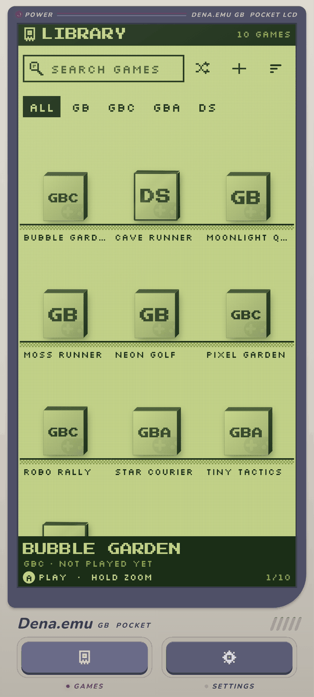
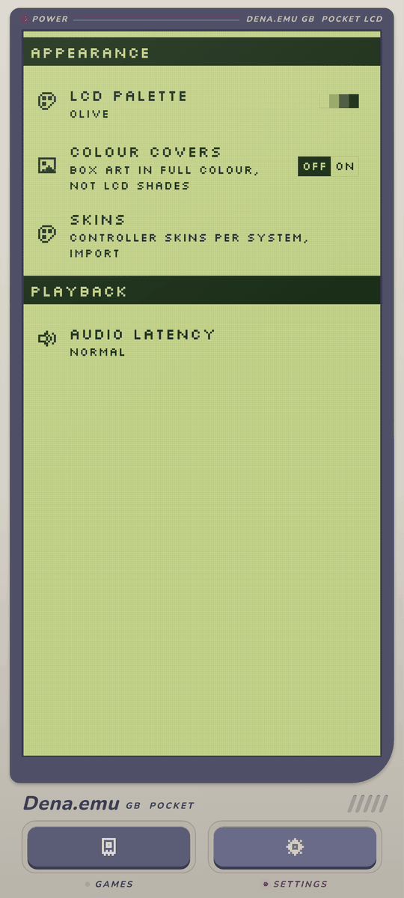
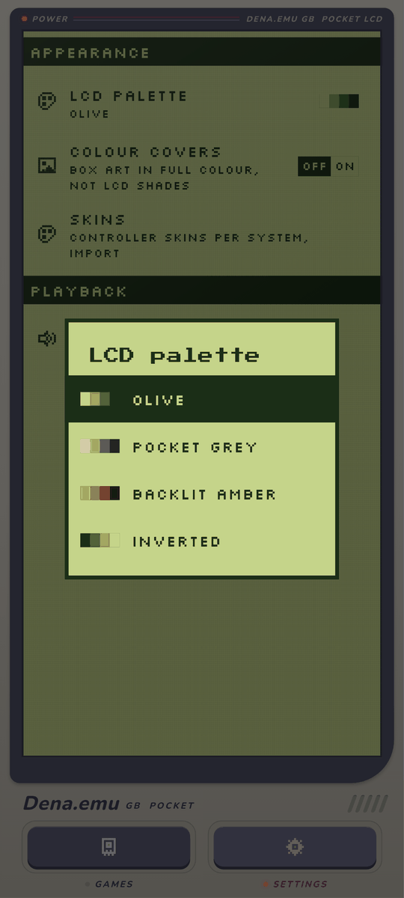
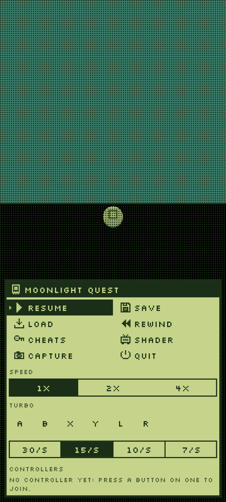
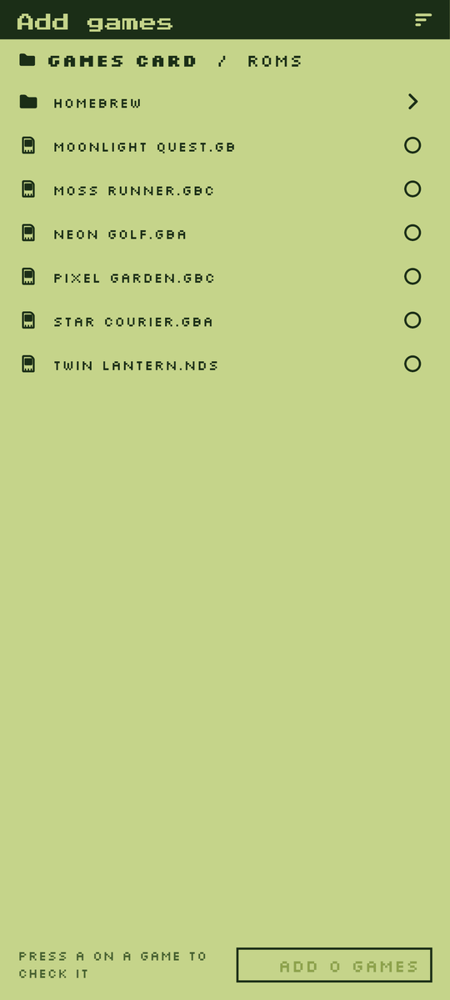

<p align="center"></p>

# Dena.emu GB

An emulator for Android that plays Game Boy, Game Boy Color, Game Boy Advance
and DS games with the look of a pocket handheld: a dot matrix LCD filter on
every game (per-console styles, intensity and LCD palettes), covers in LCD
shades, and a UI that is fully usable by touch or by gamepad. Free, with no
ads and no paid features. GPL-3.0-or-later.

No ROMs or BIOS files are included or downloaded. Bring your own games.

## Screenshots

Rendered from the app's own screens with made-up game names (`app/tool/screenshots_test.dart`).

| Library | Settings | LCD palettes |
| --- | --- | --- |
|  |  |  |

| Pause menu | File browser |
| --- | --- |
|  |  |

## Download

Get the APK from [Releases](https://github.com/Denarmo/DenaGB/releases)
(Android 8 or later, arm64). It installs as **DenaGB** (package
`app.dena.emu.gb`), beside the main Dena.emu app if you have it: the two never
share a name, a package or links.

## Features

### Systems

- **Game Boy, Game Boy Color and Game Boy Advance** with the mGBA core
- **Nintendo DS** with the melonDS core: both screens, touch on the bottom
  screen, and a pointer on the right stick when you play with a gamepad

### The Pocket LCD look

- Every screen is drawn on a four-shade pocket LCD inside a putty and slate
  shell: pixel fonts and icons, square corners, controls that invert on focus.
  On a phone the app is the console, with a bezel, a power LED and the tabs as
  rubber keys.
- Your games stand as boxes on pixel shelves, with an inverted strip under them
  showing the game in focus: title, system, playtime.
- Covers are drawn in the LCD's shades. Turn on **Colour covers** in Settings
  > Appearance to see them in full colour.

### Dot matrix LCD filter

- On by default on every game, with a style per console: green-grey cells for
  Game Boy, colour cells for Game Boy Color, Game Boy Advance and DS.
- **LCD filter intensity** slider, from the plain picture up to the full grid
  (80% by default).
- **LCD palettes** for the Game Boy screen and the app together: Olive (the
  default), Pocket grey, Backlit amber and Inverted.

### Library and import

- Game library with box art, search, system filters, favourites and recently
  played
- **Built-in file browser** to add games or whole folders, so imports work
  even where the system picker hides files; the system picker and Android's
  share sheet work too
- `.gb`, `.gbc`, `.gba`, `.nds` and `.zip`

### Playing

- Auto-save on exit and resume where you left off; battery saves
- Save states with screenshots, quick save and load
- Rewind, fast-forward (2x and 4x) and turbo buttons
- Cheats (Game Genie, GameShark, Action Replay and raw codes) and screenshots
- RetroAchievements, with hardcore mode
- Link cable over Wi-Fi between two phones for Game Boy, Game Boy Color and
  Game Boy Advance

### Controls

- Touch controls with bundled skins per console, and `.deltaskin` skins
- Gamepads (Xbox, DualShock and DualSense, Switch Pro, 8BitDo and others) and
  keyboards, with remapping per game and per controller
- The last input wins: touch shows the skin, a button press hides it and shows
  the focus ring. Every screen works with the D-pad alone.

### Shortcuts and links

- Pin a game to the home screen; it starts straight away, with no app chooser
- Every game has a `denagb://play/<sha1>` link that opens it from other apps

## Cores

| System | Core | License |
| --- | --- | --- |
| GB / GBC / GBA | mGBA | MPL-2.0 |
| Nintendo DS | melonDS | GPL-3.0 |

## Layout

| Path | What |
| --- | --- |
| `app/` | Flutter app (UI, library database, FFI bindings) |
| `host/` | C/C++ libretro frontend, shaders and headless test harness |
| `cores/` | libretro core build scripts |
| `shells/` | platform shells (Android is the one this app ships) |
| `tools/` | icons, skins, rig and license scripts |
| `docs/` | specs, provenance and licenses |

Specs are in [docs/specs](docs/specs); what this fork changes from Dena.emu is
in [docs/dev/gb-fork.md](docs/dev/gb-fork.md).

## Build and test

```bash
cmake -S host -B host/build && cmake --build host/build && ctest --test-dir host/build
cd app && flutter test
python tools/licenses/check_licenses.py
```
